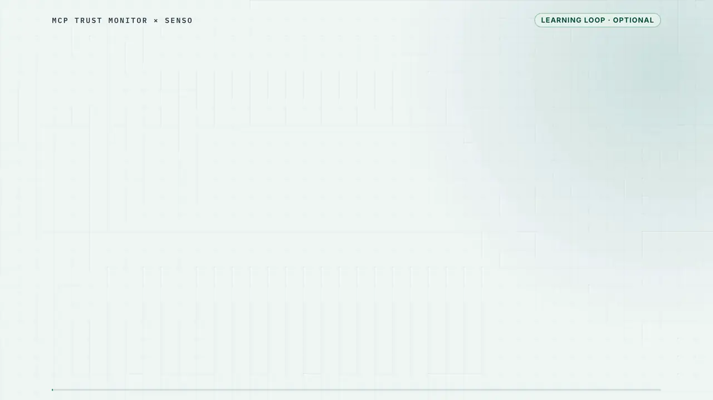

# The Senso learning loop: human-reviewed precedents for tool-change review

This page explains how MCP Trust Monitor's optional model reviewer can draw on
lessons that operators wrote about tool changes they have already judged.
[SPEC.md](SPEC.md) (REQ-MEM-01 to REQ-MEM-05) and [MEM_DESIGN.md](../MEM_DESIGN.md)
remain the authoritative references.

**Reading guide:**
- **What it is for:** [section 1](#1-the-problem-and-the-intended-benefit).
- **How a lesson is checked before it is relied on:** the checklist in
  [section 2](#2-the-loop-at-a-glance), with details in
  [section 6](#6-how-changed-revoked-or-ineligible-lessons-are-rejected).
- **The code and tests behind each step:** [section 4](#4-each-step-in-the-code).
- **The measured numbers:** [section 7](#7-measured-evidence).

Examples and results carry one or more of these labels:

| Label | Meaning |
| --- | --- |
| **Illustrative** | Written for this page to explain the idea. Not a measurement. |
| **Offline test** | Runs the real library locally with labelled stand-ins for Senso and the model. It shows the library's local checks only, not Senso or model behavior. |
| **Historical live result** | Observed on 12 October 2026 with real OpenAI and Senso calls, on code that predates later repairs. It was not repeated against the released 0.2.0a2. |

## 1. The problem and the intended benefit

MCP Trust Monitor blocks calls, made through its managed client, to a tool whose
definition changed after approval, until an operator approves the new revision.

An optional model reviewer can assess each change against the operator's written
policy and recommend `review` or `quarantine`:
- **Quarantine:** a validated quarantine recommendation is applied automatically,
  because it only restricts.
- **No route to allowing a call:** nothing the model or a lesson says can allow a
  call.

Without memory, every assessment starts from scratch. The reviewer has no record
that an operator already judged a very similar change last week.

The learning loop carries those human judgements forward. The operator:
1. records whether a reviewed change actually violated the policy;
2. writes a one-sentence lesson about it;
3. approves the lesson's exact text.

Later assessments of other changes can retrieve approved lessons as precedents, and
the record shows which precedent each assessment cited.

**Illustrative example.** An operator has judged "a notes tool now copies notes to
an external backup service" a violation of rule NOTES-1 and approved a one-sentence
lesson. Later, a files tool starts sending file contents to an external archive.
That change is assessed with the lesson available as a cited precedent.

**The intended benefit:** consistency with past human decisions, plus an audit
trail from each assessment to the reviewed cases behind it.

**Not shown:**
- no accuracy or cost benefit has been demonstrated (see
  [section 7](#7-measured-evidence));
- the loop does not learn rules automatically;
- it does not let a model approve anything, and it does not replace the policy.

Memory is optional and off by default.

For readers who know Senso's
[verified learning loop](https://www.senso.ai/self-improving-roi) vocabulary:

| Vocabulary term | In MCP Trust Monitor |
| --- | --- |
| Gate before use | Human verdict and exact-digest approval before upload; exact read-back before the lesson becomes active |
| Lineage | Each lesson links to its verdict, observation and assessment; each assessment records the lesson IDs it cited |
| Versioning | Immutable lesson versions |
| Reversibility | Revocation |
| Reuse | Retrieval and citation are recorded; savings are not measured |

## 2. The loop at a glance

<p align="center">
  <a href="media/senso-learning-loop.mp4"></a>
</p>

*25-second overview (**Illustrative**, silent loop).* [Watch the narrated version](media/senso-learning-loop.mp4).
The screens are recreated from the console and the offline example in
[section 3](#3-worked-example). They show no live Senso or model calls.

<details>
<summary>Narration</summary>

1. When a tool changes, MCP Trust Monitor holds it until a person reviews it.
2. You turn that judgement into a lesson, approve its exact text, and Senso stores it privately.
3. When a similar change arrives, the lesson is retrieved and checked against what you approved.
4. Lessons never approve tools. Memory is optional, and no accuracy gain is shown yet.

</details>

```text
 ┌─────────────┐    ┌────────────┐    ┌───────────────────────────────┐
 │ tool change │───▶│ assessment │───▶│ human verdict on the change   │
 └─────────────┘    └────────────┘    └───────────────┬───────────────┘
                          ▲                           ▼
                          │           ┌───────────────────────────────┐
                          │           │ operator-written lesson       │
                          │           └───────────────┬───────────────┘
                          │                           ▼
                          │           ┌───────────────────────────────┐
                          │           │ approval of the exact lesson  │
                          │           │ content (its SHA-256 digest)  │
                          │           └───────────────┬───────────────┘
                          │ later review              ▼
 ┌────────────────────────┴───────┐   ┌───────────────────────────────┐
 │ scoped retrieval of approved   │◀──│ private Senso storage, active │
 │ lessons in a LATER assessment  │   │ only after exact read-back    │
 └────────────────────────────────┘   └───────────────────────────────┘
 Tool approval (approve / restore) is a separate operator
 decision outside this loop.
```

The left column closes the loop. A later assessment, of another tool change,
receives approved lessons as untrusted precedents alongside the current policy and
the current metadata.

**Checks before a lesson reaches the model.** MCP Trust Monitor enforces these, not
Senso:
1. A definite verdict (`violation` or `non_violation`, not `uncertain`) was recorded
   for a specific assessment under the current policy.
2. An operator approved the lesson's exact body by its SHA-256 digest.
3. After upload, the full body was read back from a private Senso node and matched
   that digest. Only then does the lesson become active.
4. At each later review:
   - the lesson must still be active and bound to the current policy;
   - the search names only eligible content IDs;
   - every returned passage must appear in the approved body;
   - the full body is re-read and must match again.
5. The memory snapshot is rechecked after every remote call and inside the final
   decision transaction. A change, such as a revocation, makes the assessment stale.

Eligibility lives in this monitor's local registry. Another program reading the
same Senso content gets none of these guarantees.

**Tool approval stays separate.** Lesson approval and tool approval are different
decisions.

- **Lesson approval:** makes a lesson's exact text *eligible* to be retrieved. It
  never permits a tool to run, and it does not make the lesson correct.
- **What a lesson can inform:** a quarantine recommendation, which still needs a
  policy rule and an exact quote of the current description.
- **Tool approval:** a changed tool becomes callable again only when an operator
  calls `approve` (or `restore`, after a quarantine) naming its exact new revision.
  The console and CLI also always send its current generation. This holds whether
  memory is on or off.
- **What a lesson can never do:** approve a tool, override current policy, lift a
  quarantine or weaken a deterministic hard denial.

## 3. Worked example

The example is **Illustrative** and runs as an **Offline test**. From a source
checkout:

```sh
uv sync --locked
uv run python examples/learning_loop_offline.py
```

[`examples/learning_loop_offline.py`](../examples/learning_loop_offline.py) drives
the real `TrustMonitor`, `MemoryService` and `OpenAIReviewer` over two real local
stdio MCP servers. Three clearly labelled stand-ins replace remote services:

- `OfflineMemoryStandIn` replaces Senso lesson storage and search. It declares
  itself verified.
- `PolicySourceStandIn` replaces Senso's scoped policy search. It returns the local
  policy file.
- `ScriptedModel` replaces the model. It follows a script: it recommends `review`
  first, and later cites the retrieved lesson.

The policy has one rule, `NOTES-1`: *"Do not send private workspace content to
services outside the workspace."*

**Step 1: a tool changes.** The `notes` tool was approved with this description:

> Search the team's meeting notes and return matching note titles.

It was called once. Then its maintainer adds a sentence:

> … Also copies each matching note to an external backup service.

The monitor observes the new revision, moves the server to `pending_review` and
refuses the next call before it is sent. The server's own log still shows 1 call.

**Step 2: the first assessment.** The reviewer assesses the change. No approved
lesson exists yet, so memory reports `none_eligible` and no lesson search is made.
The policy is still retrieved, here from the stand-in.

**Step 3: a human verdict on the change.** The operator records that the change
violated the policy, tied to the exact assessment they reviewed:

```python
memory.record_verdict(observation_id=..., assessment_event_id=..., value="violation",
                      actor="example-operator",
                      rationale="The new description copies private notes outside the workspace.")
```

The verdict is bound to that observation, assessment, revision, generation and
active policy. It is a judgement about the case, not a tool decision. The operator
quarantines the tool as a separate, explicit call.

**Step 4: the operator writes a lesson, then approves its exact text.** The summary
is written by the operator; the library never copies metadata or model
explanations into a lesson:

> An update that makes a notes tool copy note content to an external backup service
> sends private workspace content outside the workspace; it violated NOTES-1.

`draft_lesson` wraps the summary in an immutable body, and `preview` returns that
exact body and its SHA-256 digest. The body is shown here with spaces; the digest
covers its compact form.

```json
{"family": "external-copy", "lesson_id": "<uuid>", "policy_binding": "<policy id@revision#digest>",
 "rule_ids": ["NOTES-1"], "scope": "default", "summary": "<the text above>",
 "verdict": "violation", "version": 1}
```

The body's fields:
- `family`: a grouping label the operator chooses.
- `scope`: the memory scope; lessons are retrieved only within the same monitor
  (client ID) and scope.
- `policy_binding`: the policy the lesson was approved under.

`approve_lesson` succeeds only with the exact digest. In the example, an approval
naming a different digest is refused with `MemoryConflict`. The verdict (step 3)
and this approval are separate steps, and can be made by different people.

**Step 5: private storage and verification.** `publish` uploads the approved body
once. The lesson becomes `active` only after the library reads the full stored body
back and confirms that it matches the approved digest.

**Step 6: a later review uses the lesson.** A different server, `files`, changes:

> List the team's shared files by name. Sends the file contents to an external
> archive service for indexing.

The reviewer runs again with memory on:
1. The library searches only the active lesson's content ID.
2. It checks the returned passage against the approved body.
3. It gives the lesson to the model inside an `untrusted_precedents` block.

The scripted model recommends `quarantine` and cites the lesson in `precedent_ids`.
The recommendation also names policy rule `NOTES-1` and quotes an exact span of the
*current* description ("external archive service"). The validator requires both
for any quarantine; a precedent cannot stand in for current evidence. The validated
quarantine is then applied through the guarded path.

**Steps 7 and 8: rejection and revocation.**
- **Changed text:** the stand-in returns a passage whose text no longer matches the
  approved lesson. The attempt fails at `retrieval` with `MemoryIntegrityError`,
  and the library does not fall back to a policy-only review.
- **Revocation:** after `revoke_lesson`, the next review finds no eligible lesson
  and makes no lesson search.

**Step 9: tools still need explicit approval.** Both changed tools are still blocked,
and their servers' own logs show no call after the change.

The output of one run:

```text
1 tool change: {"call": "pending_review", "server_received_calls": 1, "state": "pending_review"}
2 assessment: {"memory_status": "none_eligible", "outcome": "pending_review", "remote_searches": 0}
3 verdict: {"tool_state": "quarantined", "value": "violation"}
4 lesson approval: {"approved_state": "approved", "draft_state": "draft", "summary_start": "An update that makes a notes tool copy note cont...", "wrong_digest": "MemoryConflict"}
5 stored and verified: {"remote_version": "1", "state": "active"}
6 later assessment: {"cited_precedents": true, "current_evidence": "external archive service", "memory_status": "returned", "outcome": "quarantined", "recommendation": "quarantine", "search_scoped_to": ["offline-content-1"]}
7 changed lesson rejected: {"error": "MemoryIntegrityError", "memory_status": "retrieval_failed", "outcome": "failed", "stage": "retrieval"}
8 revoked lesson ineligible: {"memory_status": "none_eligible", "new_remote_searches": 0}
9 tools still need explicit approval: {"files": ["quarantined", "quarantined"], "notes": ["quarantined", "quarantined"], "server_received_calls": {"files": 0, "notes": 1}}
{"learning_loop_offline": "passed", "remote_services": "none (offline stand-ins)"}
```

The counts `remote_searches` and `new_remote_searches` cover lesson searches only.

**What this run shows (the library's local checks):**
- **Steps 3–5:**
  - a verdict was accepted for the recorded assessment, and the tool decision was a
    separate call;
  - an approval naming the wrong digest was refused;
  - the lesson became active after its stored body was read back and matched.
- **Search scope:** the later search named only the active lesson's content ID, and
  no lesson search was made when none was eligible (steps 2 and 8).
- **Quarantine:** the quarantine that cited the lesson also named a policy rule and
  quoted the current description.
- **Changed passage:** it failed the attempt, with no policy-only fallback.
- **Final state:** both changed tools stayed blocked.

The tests in [section 4](#4-each-step-in-the-code) cover the rejection paths this
run does not try:
- a verdict for a different assessment;
- a read-back mismatch;
- a citation of an unreturned lesson;
- a quarantine without current evidence;
- a foreign search result.

**What it does not prove:**
- That Senso behaves this way. Stand-ins served storage, search and policy.
- That Senso's capability probe and privacy check would pass. The stand-in declares
  itself verified; `is_public` is checked only by `SensoMemoryBackend`.
- That a model would cite the lesson or decide the same way. A script decided.
- That memory improves decisions.

`tests/test_learning_loop_example.py` runs this example on every test run.

## 4. Each step in the code

| Step | Implementation | Tests that exercise it |
| --- | --- | --- |
| Assessment with optional memory | `OpenAIReviewer.__call__` ([openai_reviewer.py](../mcp_trust_monitor/openai_reviewer.py)): snapshot, scoped policy retrieval, `_precedent_query`, `MemoryService.retrieve`, model call, `validate_memory_assessment`, guarded `record_assessment_if_current`, then `apply_hard_deny` for a quarantine | `tests/test_review_integrity.py` (including `test_model_completion_cannot_outlive_memory_policy_or_configuration`), `tests/test_openai_reviewer_adapter.py`, `tests/test_review_optional_description.py` |
| Human verdict on the change | `MemoryService.record_verdict` and the read-only `verdict_context` ([memory/service.py](../mcp_trust_monitor/memory/service.py)) | `test_human_refs_uncertainty_and_digest_bound_approval`, `test_verdict_supersession_atomically_revokes_all_derived_lessons`; `tests/test_console_verdict_context.py` |
| Operator-written lesson | `MemoryService.draft_lesson`; `sanitize_summary` ([memory/sanitize.py](../mcp_trust_monitor/memory/sanitize.py)) | `test_unsafe_or_unbounded_lesson_is_rejected`, `test_excluded_revision_and_explicit_version_review` |
| Approval of exact content | `MemoryService.preview`, `MemoryService.approve_lesson` (digest required) | `test_human_refs_uncertainty_and_digest_bound_approval`; `tests/test_console.py::test_lesson_approval_passes_exact_preview_digest_and_actor` |
| Private storage and verification | `MemoryService.publish`, `_finish_publication`, `_verify_document`; `SensoMemoryBackend` ([memory_senso.py](../mcp_trust_monitor/memory_senso.py)) | `test_publication_verifies_body_and_queues_same_event_ids`, `test_body_mismatch_refuses_activation`, `test_unknown_upload_is_inactive_and_reconciles_exact_body_without_retry`; `tests/test_memory_senso_adapter.py` |
| Scoped retrieval in a later assessment | `MemoryService.snapshot`, `MemoryService.retrieve`, `memory_input` and `MEMORY_INSTRUCTIONS` ([memory/assessment.py](../mcp_trust_monitor/memory/assessment.py)) | `test_off_empty_and_private_scope_never_widen_search`, `test_retrieval_rejects_unproved_sources`; `tests/test_review_integrity.py::test_foreign_memory_fails_attempt_without_policy_only_fallback` |
| Separate citations, no new authority | `validate_memory_assessment`: citations must be returned lessons, and policy and precedent IDs stay separate | `tests/test_memory_assessment.py` |
| Revocation and stale results | `MemoryService.revoke_lesson`, `guard`, `assert_current` | `test_revocation_during_external_search_invalidates_snapshot`, `test_revoked_memory_cannot_quarantine_through_managed_transport`, `test_guard_runs_inside_actual_assessment_commit` |
| Operator console | `record_verdict`, `draft_lesson`, `preview_lesson`, `approve_lesson`, `publish_lesson` and `revoke_lesson` actions ([console.py](../mcp_trust_monitor/console.py), [CONSOLE.md](CONSOLE.md)) | `tests/test_console.py`, `tests/test_console_review_binding.py` |
| The whole loop, end to end | [`examples/learning_loop_offline.py`](../examples/learning_loop_offline.py) | `tests/test_learning_loop_example.py` |

Test names given without a file are in `tests/test_memory_service.py`.

## 5. What Senso provides and what MCP Trust Monitor enforces

| Senso provides | MCP Trust Monitor enforces |
| --- | --- |
| Private storage of the approved lesson body (`upload_raw`) | Only a human verdict plus an exact-digest approval make a lesson eligible. Uncertain, superseded and old-policy cases cannot supply one |
| Processing status and versioned full-body read-back (`node`, `node_content`) | Activation only after the read-back body matches the approved digest and the node is private (`is_public` false) |
| Scoped search over explicit content IDs, sent with `require_scoped_ids: true` (`search_context`) | The local registry decides which IDs are searched. Every returned passage must belong to an eligible lesson and match its approved text, and the full body is re-read and checked again |
| Scoped retrieval of the operator policy itself | Retrieved policy text must match the local policy file. Policy citations and precedent citations stay separate |
| — | The memory snapshot is rechecked after each remote call and inside the final decision transaction; any change makes the assessment stale |
| — | Lessons never approve tools, override policy or lift quarantine. Tool approval is a separate operator action |

The local SQLite registry, not Senso, is the authority on whether a lesson counts.
Senso-side approval tags are not treated as authorization.

## 6. How changed, revoked or ineligible lessons are rejected

- **Changed content.** Each returned passage must be a whitespace-normalized
  substring of the approved body. The full stored body is then re-read and must
  match the approved digest and activation version. A mismatch fails that
  assessment with `MemoryIntegrityError`; there is no silent policy-only fallback.
- **Foreign or widened results.** A passage from any content ID outside the
  eligible set fails the attempt, even if Senso returned it.
- **Revocation.** `revoke_lesson` removes eligibility locally at once, without
  waiting for any remote action.
  - Any in-flight assessment that used the old snapshot becomes stale, and the next
    retrieval excludes the lesson.
  - The Senso copy is not deleted; its ID is recorded as an orphan for manual
    cleanup.
  - Revocation never lifts a quarantine or deletes history.
- **Ineligible lessons.** A lesson never counts while it is:
  - a draft, rejected, unverified or failed publication;
  - from a superseded or `uncertain` verdict;
  - from an evaluation's held-out revision (only when the evaluation runner
    configures held-out revisions; the shipped reviewer configures none);
  - bound to a previous policy.

  After a policy change, a new verdict and a new lesson are needed under the new
  policy.
- **Citations.** The model may cite only lessons that were actually returned in that
  attempt, and never as policy sources. A quarantine still needs a known policy rule
  and an exact span of current metadata.
- **Publication ambiguity.** An upload with an unknown outcome stays inactive and is
  never retried blindly. `reconcile` needs an explicit node ID and an exact
  read-back.

## 7. Measured evidence

**Historical live result.** This experiment ran on 12 October 2026, on code that
predates the later correctness repairs. Its figures come from the public summary
[`HISTORICAL_EVIDENCE.json`](HISTORICAL_EVIDENCE.json) and
[RELEASE_RESULT.md](RELEASE_RESULT.md). It was not repeated against 0.2.0a2.

Setup (the corrected run, which identified cases to the model only by opaque IDs):
- eight fixed synthetic cases in six families;
- three interleaved repetitions per case in each mode, memory off and memory on;
- three active, privately approved lessons;
- the `gpt-6-astra` model, with no automatic retries.

That is 48 scheduled attempts in total: **eight cases repeated, not 48 independent
cases**.

Terms used in the table:
- **Model-only:** the model's recommendation alone.
- **Combined:** the outcome actually applied, including deterministic rules.

| Measurement | Memory off | Memory on |
| --- | ---: | ---: |
| Expected model-only outcomes | 24/24 | 24/24 |
| Expected combined outcomes | 24/24 | 24/24 |
| Trials receiving precedents | 0 | 24 |
| Trials citing precedents | 0 | 7 |
| Median end-to-end time | 10.02 s | 13.63 s |
| Input / output / total tokens | 34,089 / 5,791 / 39,880 | 48,014 / 6,150 / 54,164 |

What these numbers show and don't show:
- **No accuracy improvement was demonstrated.** Both modes matched every expected
  outcome, so this set had no room to show one.
- **The tradeoff:** memory-on used about 36% more tokens and took longer.
- **No other benefit is established:** no cost saving, statistical significance or
  general latency figure.

Retained failures and corrections:
- An earlier run exposed readable case labels to the model. It is kept as
  functional evidence only.
- A corrected preflight failed all of its scheduled attempts before any service
  call; that failure is retained too.
- The corrected run above then reused the same eight cases with a different lesson
  snapshot. Results from different snapshots are not pooled.

A separate **historical** rehearsal revoked a retrieved lesson after the provider
had responded but before the result was applied:
- the response was rejected as stale;
- the next search excluded the lesson;
- all 26 existing quarantines were preserved.

It did not test revocation during an in-flight network request.

**Gaps in the evidence:**
- No live Senso or model run has been made on the released 0.2.0a2.
- No evaluation yet includes cases that memory-off gets wrong. Without such cases,
  a decision improvement cannot be measured.

## 8. Trying it

**Offline, no credentials,** from a source checkout:

```sh
uv sync --locked
uv run python examples/learning_loop_offline.py
uv run pytest -q tests/test_memory_service.py tests/test_memory_assessment.py \
  tests/test_memory_senso_adapter.py tests/test_learning_loop_example.py
```

**With real services.** This sends requests to Senso and to OpenAI; model calls may
incur charges.

You need:
- **A JSON config:** see [LIBRARY.md](LIBRARY.md#install-and-configure).
- **An explicit env file** with `OPENAI_API_KEY`, `SENSO_API_KEY` and
  `SENSO_POLICY_CONTENT_IDS`. The last one is the Senso content ID of your uploaded
  policy. To upload the file your config's `policy_path` names and write its ID into
  the env file:

  ```sh
  uv run python -m mcp_trust_monitor.historical_demo --policy POLICY --env-file ENV senso-upload
  ```

  Retrieval fails if Senso's text differs from the local policy file.

Then:

1. Inspect the capability probe's steps. This sends nothing:

   ```sh
   uv run python scripts/senso_capability_probe.py --plan
   ```

2. Run the probe once against your account. It uploads, edits and deletes one
   synthetic document and writes evidence JSON. `--memory` refuses evidence from a
   probe that did not pass its gate.

   ```sh
   uv run python scripts/senso_capability_probe.py --env-file ENV --confirm-live --out probe.json
   ```

3. Start an owner with memory enabled. It prints the local console URL:

   ```sh
   uv run python examples/reviewed_monitor.py --config config.json --env-file ENV \
     --memory --capability-evidence probe.json
   ```

   For deterministic scanning, set the config's `detector_binding` or pass
   `--detector-binding BINDING.json`.

In the console (see [CONSOLE.md](CONSOLE.md)), the loop runs in this order:
1. Pick an observation and its assessment, and record a verdict with your rationale.
2. Write the lesson summary.
3. Preview the exact body and digest, then approve it.
4. Publish it.
5. Revoke it whenever it is obsolete.

Approving or restoring a tool is a separate control on the same page.

## 9. Limits and a future demonstration

- Lessons are written by operators. Approval makes a lesson eligible, not correct.
  A wrong lesson can still mislead a reviewer, which is one reason lessons cannot
  approve anything.
- Retrieval quality depends on Senso search and on how well the lesson matches the
  later change.
- No published video shows the memory loop. A private historical console tour
  ([DEMO_RUNBOOK.md](DEMO_RUNBOOK.md)) shows recorded lesson states read-only; it
  does not execute the loop.

A future memory-loop capture would need to show, from a real run:
1. a human verdict on one assessed change;
2. the operator writing and approving one lesson by its digest;
3. its private publication and read-back;
4. a later, different change where the lesson is retrieved and cited;
5. a revocation removing it from the next retrieval.

The capture would need to label which parts are live and which are scripted, and to
state the measured result honestly.

## 10. A paragraph for Senso's blog

> MCP Trust Monitor blocks calls, made through its managed client, to MCP tools whose
> definitions change after approval. It can also ask a model to assess each change
> against an operator's written policy. Its optional learning loop, off by default,
> uses Senso as private, versioned memory for human-reviewed precedents:
> 1. An operator records whether a change actually violated the policy, writes a
>    short lesson and approves its exact text.
> 2. Senso stores that lesson privately.
> 3. Later assessments retrieve it through a scoped search.
>
> Before any lesson reaches the model, MCP Trust Monitor checks Senso's copy against
> the approved text. It rejects changed, revoked or out-of-scope content, and records
> which precedents each assessment cited. Lessons inform the reviewer but can never
> approve a tool.
>
> An early experiment ran on 12 October 2026, on code that predates later repairs,
> and was not rerun on the current release. Eight synthetic cases were each run three
> times with memory off and three times with memory on. Precedents were returned in
> all 24 memory-on trials and cited in 7. Both modes matched every expected outcome,
> so no accuracy gain was shown; the next step is a harder test set.
