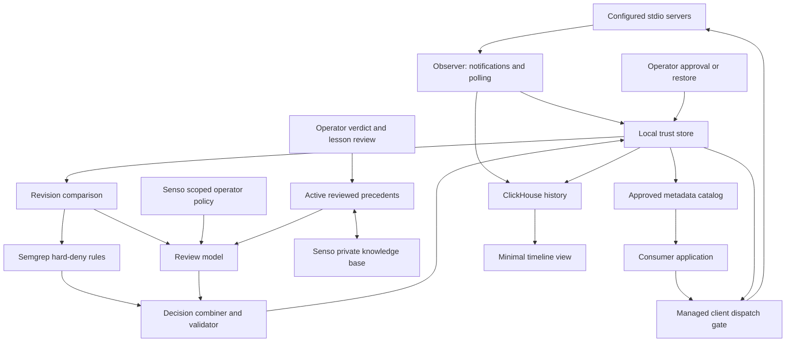

# MCP Trust Monitor specification

Updated 10 October 2026 for the first reusable Python library release. This is the authoritative requirements document. Existing `REQ-…` IDs retain their meaning; extensions and corrections are recorded in [HANDOFF.md](HANDOFF.md). [BUILD_PLAN.md](BUILD_PLAN.md) defines implementation order and review gates. Requirements describe the target, not a claim that the target is already implemented.

## Product decision and release boundary

Build a Python library that controls which observed MCP tool definitions an application may expose to its agent and call, records why trust changed, and lets explicitly reviewed cases inform later assessments.

The user is a Python agent developer or platform engineer. The first release supports explicitly configured **local stdio servers**, one application process owning a trust store, one active operator policy, a generic CLI, and one local review console. The developer integrates protected discovery and calls into their application; unrelated MCP clients are not protected automatically.

**Promise:** withhold unapproved metadata from the protected catalog; refuse dispatch when approval, identity, revision or freshness checks fail; assess observed changes against policy; apply warranted quarantine through guarded transitions; preserve traceable evidence. Precedents can inform a recommendation, never authorize a call.

**Boundary:** metadata does not prove server code is safe. Connecting to stdio launches executable code even when the only protocol requests are initialization and metadata listing. This library is not a process sandbox. A server can misrepresent its behavior or change between observations. Previously exposed metadata cannot be erased from an agent's existing context.

Out of scope for this release: HTTP/OAuth transports, arbitrary-client proxies or desktop plug-ins, distributed writers, hosted multi-tenant services, automatic approval, generated detection rules, model fine-tuning, tool-output inspection, public crawling, and automatic public accusations. Expansion needs its own specification and acceptance evidence.

## Historical baseline versus target

This table describes the starting point at `0c13bfc`, not the current candidate.
The 12 October parallel implementation is tracked in
[TODAY_EXECUTION.md](TODAY_EXECUTION.md); final local acceptance and limits are
recorded separately in [RELEASE_RESULT.md](RELEASE_RESULT.md). Requirements below remain unchanged;
implementation and passing a release gate are separate claims.

| Area | Reviewed baseline at `0c13bfc` | Library work required from that baseline |
| --- | --- | --- |
| Enforcement | M1 revision/policy-bound approval, shared failure invalidation, explicit recovery and persistent quarantine | Approved catalog, endpoint/config binding, owner coordination, freshness |
| Detection/history | M2 isolated Semgrep, transactional SQLite outbox, manual ClickHouse delivery and deduplicated read-back | Generic orchestration and background delivery |
| Assessment | M3 scoped Senso policy, bounded OpenAI recommendations, exact evidence validation | Optional adapters, separately governed precedent retrieval, whole-result context status |
| Evaluation | Six fixed cases matched once; latest historical full suite reported 142 passes | Independent installed consumer, held-out memory comparison, integrity cases |
| Distribution | Package metadata and configurable internal stdio client; demo-specific CLI/default paths | Public API, resource-safe wheel, generic config/CLI, tested compatibility |
| Monitoring/learning/UI | Scripted demos; no polling, freshness gate, lessons or console | All of these are planned, not implemented |
| Release | Public `main` and `hackathon-submission` at `0c13bfc`; recording copy at `a1f833b` | Preserve old release and recording; produce a new reviewed candidate |

The implementation at `0c13bfc` is unchanged from approved `67cd30c`; intervening commits update documentation. `docs/SUBMISSION.md` remains a historical hackathon summary. M4/M5 were not completed. These dated results are not fresh verification of new behavior.

## System design

SQLite owns authorization state, active lesson eligibility and the outbox. ClickHouse is an optional history sink, never a per-call authorization dependency. Senso retrieves policy and reviewed precedents; it does not grant trust. A single owning process provides shared per-server coordination and a serial review queue. The SDK, CLI, console and examples use the same operations.

### Library and distribution contract

- **REQ-LIB-01 Supported API.** Publish typed configuration, policy, trust, catalog, review-result, decision-record and error types. Expose observation, approved discovery, approve/restore/quarantine, protected calls, review-once, monitor lifecycle, verdict and lesson operations. Consumers must not manipulate private store internals. Async APIs use the caller's event loop; no hidden `asyncio.run`, import-time I/O, implicit launches or printing. Fix and document public signatures in L1 before higher layers depend on them.
- **REQ-LIB-02 Configuration and installation.** Accept validated external stdio server definitions, explicit policy/state/resource paths, timeouts and adapter settings. Remove demo IDs and checkout-relative files from generic paths. A file-based configuration resolves relative state, policy, working-directory and explicitly path-like executable paths, and an omitted or null server working directory, beside the configuration file, never in the invoking directory. Expand leading home-directory references in paths; retain absolute executable paths and preserve executable symlinks during configuration normalization. Bare executable names retain caller PATH lookup, while arguments and credential-reference names remain literal. Explicit executable paths therefore select one profile across invoking directories under the same home/environment settings; document the SDK's programmatic default separately. Bundle required resources or require explicit paths; never write state into the installed package. Provide a console entry point, type information, wheel/source distribution and separate consumer example. Prove imports, resources, CLI and example from the installed wheel outside the checkout.
- **REQ-LIB-03 Adapters and modes.** Core installation supports local trust, discovery, dispatch and persistence without cloud credentials. Provide explicit optional Semgrep, Senso, OpenAI and ClickHouse adapters through small interfaces, not a plug-in discovery framework. Keep Semgrep isolated from the MCP dependency. Disabled optional functionality is `disabled`, never `passed`. Enabled required detector/assessment failure cannot silently become a reduced-security mode. Explicit local-only operation still requires operator approval of changes.
- **REQ-LIB-04 Ownership and compatibility.** One process owns mutation and dispatch for a state directory, with shared per-server coordination across its sessions. Reject a second owner before launch or state mutation. CLI mutations acquire ownership and fail clearly if an owner is active; read-only snapshots may coexist. The console lives inside the owner. Specify store/resource ownership and close only owned resources. Preserve schema migrations and recovery state. Start with the reviewed `mcp` 1.30 integration and advertise only SDK/protocol/Python/OS combinations actually tested. New SDK majors and protocols need separate migration evidence.

- **REQ-LIB-05 Schema compatibility.** Under the owner lock, inspect an existing database's schema compatibility read-only before creating/changing the owner marker or performing database DDL, journal-mode changes or writes. Reject unsupported newer schemas with the database and owner marker unchanged. Read-only consumers also reject unsupported schemas but never acquire mutation ownership. Define supported versioned upgrade paths; apply each migration and its version stamp atomically under exclusive ownership. Preserve quarantine, failure prerequisites and evidence. Test interrupted upgrades and repeat opening after recovery. A read-only snapshot never migrates. Document backups and unsupported downgrades: historical binaries must not open upgraded stores; use distinct state directories and restore a compatible backup rather than lower a version marker.

### Observation and revisions

- **REQ-REV-01 Revision digests.** A tool revision is the SHA-256 digest of canonical JSON (sorted keys, description text preserved exactly) containing the tool's name, description, and input schema. A server revision is the digest of its sorted `(tool name, tool revision)` pairs, so additions and removals are changes. Duplicate tool names make an observation invalid. For this release the protected catalog exposes only these covered definition fields. Do not forward initialization instructions, annotations, titles, output schemas or other uncovered metadata through that catalog. Adding exposed fields requires a versioned digest change and migration that cannot silently preserve old approval.
- **REQ-REV-02 Valid observations only.** Observation collects `tools/list` metadata only and never invokes `tools/call`. Complete pagination and validate responses before accepting an observation. A connection or initialization failure, timeout, malformed response, or partial list is an observation failure, and it never yields a clean result or an approval.
  - In one local transaction, an approved server moves to pending review and `observation_failed` is recorded. A quarantined server stays quarantined.
  - Every session of that managed client then blocks, not only the one that failed, and the failing session is closed.
  - Recovery requires a successful observation of valid metadata, then explicit operator approval, in that order. The trust store enforces this:
    - Approve and restore are refused until a complete successful observation is recorded after the latest failure.
    - The requirement is persisted and survives restart.
    - The recovering observation counts as evidence even when the metadata is unchanged. It bumps the generation, so earlier decisions become stale, but it never restores approval by itself.
    - Another failure before approval re-arms the requirement.
- **REQ-REV-03 Capture metadata.** For each accepted observation, retain the UTC timestamp, logical server name, endpoint identity, version if available, transport, raw metadata, and origin (`live` or `synthetic_fixture`). Never persist transport/config credentials, secret environment values or credential-bearing URLs/arguments in identity or audit records. Raw tool metadata can itself contain sensitive text: it is not automatically a secret-free export. Capture only configured metadata and sanitize or refuse exports; never upload unrelated workspace content.

- **REQ-REV-04 Launch/config identity.** Bind trust to a validated launch profile, not only logical server ID. Cover executable, argument configuration, working directory, non-secret environment configuration and credential-reference identities; never serialize secret values into identity records. Define normalization and secret references explicitly. Changed launch configuration invalidates approval before connection/dispatch even if metadata is identical. Legacy identity-less records need fresh observation and explicit approval; migration preserves quarantine and failure markers. Configuration identity is not a binary signature or proof of code integrity.
  - *Clarified by the 16 October 2026 corrective repair (D1).* Trust and dispatch bind to the identity of the running session, not a later recomputation: the identity captured before spawn must still equal the configured identity after initialization and after observation (and the record's identity before an observation is recorded), otherwise it is an observation failure; a session whose identity differs from the record's never dispatches or contributes to protected discovery.
- **REQ-REV-05 Explicit launch boundary.** Start only caller-configured launch profiles with explicit environment scope and no shell interpolation. Do not auto-launch commands from public registries or untrusted imported configurations. Document that metadata observation executes the configured server process. Host-provided sandboxing is optional and external; the library makes no sandbox guarantee.

A changed digest means changed metadata, not maliciousness. Authentication and self-declared tool annotations do not establish policy compliance.

### Trust state and enforcement

Trust is scoped to `(managed client/owner, server and launch identity, server revision, policy revision)`. Dirty/freshness conditions gate access in addition to persistent trust state; launch identity binding is a new release requirement. The local store keeps the current observed revision, the approved revision, the policy revision of that approval, the state, and a monotonic generation that increases on every transition.

| Event | Next state | New calls through the client |
| --- | --- | --- |
| First observation | Unreviewed | Blocked |
| Explicit operator approval of the current revision (refused while an observation failure awaits a successful observation) | Approved | Allowed |
| Approved revision observed unchanged | Unchanged | Allowed only while all session/identity/freshness checks pass |
| Observed metadata, active policy or launch identity changes | Approved becomes pending review; quarantine preserved | Blocked |
| Observation failure (connection, initialization, or `tools/list`) | Pending review; quarantine preserved | Blocked |
| Review recommendation, failed/rejected/stale assessment | No trust transition; preserve quarantine, pending or explicit approval | Existing gates still apply |
| Dirty notification or expired freshness | Preserve state; gate dirty/stale until successful refresh | Blocked |
| Hard-deny match or validated quarantine recommendation | Quarantined | Blocked |
| Operator quarantine | Quarantined | Blocked |
| Explicit operator restore of a named revision (same observation requirement) | Approved | Allowed |

- **REQ-ENF-01 Dispatch gate and explicit refresh.** The managed client reads persisted trust immediately before every `tools/call` dispatch, under shared per-server coordination across sessions. An ordinary `call_tool` never launches or contacts a server when any gate fails, including missing session freshness. It requires a live session whose own successful, fresh observation matches current trust. A refused call is never written to the transport.
  - Provide an explicit SDK `observe_and_call` operation and CLI `call --refresh`. First check persistent approval, revision, policy, launch identity, storage health and any supplied selection token, allowing only the session's missing, expired, dirty or no-longer-current observation to need refresh. Pending, unreviewed, quarantined, identity/policy-invalid or faulted state blocks without launch. Then perform a complete metadata observation and recheck every gate before tool dispatch. A change or failure blocks; this operation never approves. Metadata observation still executes the configured stdio process.
  - Plain CLI `call` from a new process reports `session_refresh_required`; its documented success path is `call --refresh`. Separate clean `observe`, then `approve`, then `call --refresh` invocations must work. Standalone `observe` remains the explicit operation for inspecting or recovering pending/quarantined state. This is a deliberate CLI behavior change, not an implicit relaxation of the no-launch gate.
- **REQ-ENF-02 Approved revision only.** A call is dispatched only when the server is approved, its current observed revision equals the approved revision, the approval's policy revision equals the active policy revision, and the tool exists in that revision. The library additionally checks current launch identity and dirty/freshness conditions. If the caller supplies a catalog selection token, compare its server, launch identity, revision, generation and policy binding; reject any mismatch even if the replacement is approved or has identical metadata. Never silently retarget a stale selection. Tokenless legacy calls retain explicitly documented latest-approved semantics while still passing every current gate. Every other condition blocks.
- **REQ-ENF-03 Quarantine blocks dispatch.** After quarantine, no subsequent call is dispatched through this client. Independent unchanged server-side counters prove this in instrumented tests; generic servers may supply no counter (REQ-AUD-02). On quarantine the client closes that server's connection and drops its cached tool list.
- **REQ-ENF-04 Isolation.** Blocking, reviewing or quarantining one server does not prevent unrelated approved-server calls. Bound background work and avoid a global lock held across external requests.
- **REQ-ENF-05 In-flight honesty.** Calls dispatched before quarantine may already have executed. Record dispatch start separately from completion and distinguish in-flight/outcome-unknown calls from locally refused calls; never claim retroactive prevention. Detailed in-flight reporting is an extension beyond the baseline completion-time call event. Do not hold the trust/dispatch lock while awaiting the tool's response: observation invalidation and quarantine must still commit. Coordinate the final gate with request enqueue; a notification handler must not block the response reader while awaiting that lock. Test a tool-list notification and quarantine before an in-flight response arrives.
- **REQ-TRU-01 Explicit approval.** The first observation of a server is unreviewed. An observed baseline is not an approved baseline; the demo's initial approvals are explicit operator actions.
- **REQ-TRU-02 Revision binding.** Every authorizing decision names the exact server revision and is bound to the active policy revision. It is rejected unless that revision is still current; when it also names a generation, that generation must still be current. New console approval/restore actions must supply both; preserve compatibility with the baseline CLI optional-generation contract. A stale decision can never authorize a newer revision.
  - *Added by the 13 October 2026 operator-decision repair (review finding R2); the earlier wording did not require it.* The generation also binds the active policy for every record, not only approved ones: an approve or restore input prepared before a genuine policy change is stale afterwards, whatever the server's state (REQ-TRU-03).
  - *Added by the same repair (R1).* The console's approve/restore request also carries the active policy binding and launch identity the operator reviewed. The console backend refuses the request when either supplied value is no longer current, in addition to the revision and generation checks. The generation stays the authoritative binding: a genuine policy or launch-identity change advances it.
- **REQ-TRU-03 Change invalidation.** An observed metadata change, or a change of active policy, moves an approved server to pending review before the next dispatch. Observing a previously approved revision again does not restore approval. Extend invalidation to changed launch identity under REQ-REV-04. An explicit owner policy-reload operation must atomically update active policy and invalidate affected approvals before further discovery/dispatch; a policy-file watcher is not implied.
  - *New requirement from the 13 October 2026 operator-decision repair (review finding R2). It strengthens the contract; the earlier wording invalidated only approved servers.* A genuine policy change is an activation whose binding differs from the last binding activated for the client scope, in this owner lifetime or an earlier one; an owner reopen with a different policy file is one. In the same atomic activation step, it advances the generation of every unreviewed, pending-review and quarantined record, without changing its state, and records `decision_context_invalidated`. Quarantine is preserved. Reactivating the same binding is a no-op and advances no generation, including the first per-server activation marker written on an owner reopen with an unchanged policy. A store with records but no recorded previous activation cannot show its previous policy; its first activation counts as a change (fail closed).
- **REQ-TRU-04 Persistent quarantine.** Trust transitions are persisted atomically and survive client restart. Quarantine is lifted only by an explicit operator restore of a named revision, which records its actor. After an observation failure, a restore is also refused until a successful observation follows it (REQ-REV-02). No observation, reconnection, or reset lifts it.
- **REQ-TRU-05 Operator approval of changes.** Changed definitions become callable only through explicit operator approval. A benign assessment leaves a changed revision pending until then. Harmless fixtures should not be quarantined, but a fallible model may false-quarantine; report that error rather than promising it cannot happen. Preserve operator approval/restore without a mandatory clean scan; do not silently add scan gates or override flags.
- **REQ-TRU-06 Idempotent decisions.** Duplicate state application does not repeat transition side effects; repeated attempts may have separate audit events. Publication and delivery use stable operation IDs and visible retries. Reconcile ambiguous remote writes instead of blindly duplicating authoritative records.
- **REQ-TRU-07 Per-session freshness.** Track successful-observation time, revision and dirty epoch for each live transport session. An observation older than two configured poll intervals, or an unrefreshed notification, blocks that session's protected discovery and new calls. A refresh on session A never freshens session B, even for identical launch profiles and metadata. Catalogs identify their backing session; a new/closed session has no freshness. Any observed metadata change or failure still invalidates shared server trust. Manual operation uses the same budget; stopping the monitor never disables it. Use monotonic elapsed time and require a new observation after restart. Unchanged valid refresh may satisfy the post-failure observation prerequisite but never grants approval or lifts pending/quarantine. The explicit REQ-ENF-01 composite may refresh an otherwise approved session. Expose session identity, last success and stale reason.

Operator quarantine is server-scoped regardless of revision. Stale assessments are recorded and discarded without overwriting the current trust state. Baseline deterministic context binds policy and scanned rules digest; baseline model context binds policy, Senso policy IDs and policy digest. The library also binds launch identity, review configuration and any memory snapshot (REQ-MEM-04). Check freshness of all completed assessments, including a model `review` result, before presenting them as current; baseline guarding was centered on quarantine application. Relevant context changes require a new assessment, not relabeling old output.

Quarantine operates in the managed client. Unrelated clients, external `mcp.json` edits and distributed dispatch coordination are outside this release.

### Protected discovery

- **REQ-ENF-06 Approved catalog.** Protected discovery returns immutable covered definitions only for servers currently eligible for dispatch, with server revision, generation, policy and launch identity tokens. Withhold unreviewed, pending, quarantined, dirty, stale and failed observations. Notify consumers when a catalog is invalidated; raw inspection is a separate operator API and must never masquerade as approved discovery. This cannot erase definitions already sent to a model; enforcement still happens on every call.

- **REQ-ENF-07 Authoritative-store failure.** An unreadable/invalid authoritative record or failure to commit a required local state-and-audit transaction latches the owning process into `storage_faulted`. Withdraw its protected catalogs, reject new dispatch across all sessions, and initiate bounded session shutdown; never fall back to cached approval. Surface a requested quarantine as uncommitted, not applied. Business rejections and optional remote-service outages do not create this latch.
  - After read-only schema compatibility succeeds under the exclusive owner lock, create and durably flush an unclean-owner marker and its parent directory before migration, trust mutation, server launch or dispatch. If it cannot be made durable, refuse startup. Keep it through the owner's lifetime. Remove it only after clean shutdown with no unresolved authoritative-store fault and no task able to issue further writes/calls. Remote outbox/publication work may remain durably pending at clean shutdown. Read-only snapshots never create, recover or clear this marker.
  - A pre-existing marker requires recovery before any server use: atomically move previously approved records to pending, preserve quarantine, arm the successful-observation-before-authorization prerequisite for all existing trust records in the owner's scope, including quarantined and unreviewed records, bump generations and record recovery. Retain the marker throughout recovery and the new owner's lifetime. If storage or recovery remains unusable, refuse startup. Recovery never approves: require successful observation and explicit operator approval/restore. No same-process automatic clearing of the fault latch; close, repair storage and reopen. A crash cannot discard the fault by merely re-reading old approved rows. Conservative reapproval after an unclean exit is an intentional trade-off.
- **REQ-ENF-08 No automatic tool replay.** Never automatically resend `tools/call` after dispatch, timeout, cancellation or ambiguous transport failure. The tool may already have produced side effects. Report outcome-unknown when execution cannot be ruled out; a caller's deliberate retry is a new call through current gates. Permit configured bounded retries only for explicitly classified safe metadata/retrieval operations, model-assessment requests with no tools (record attempts and any usage uncertainty), and idempotent audit delivery; lesson publication uses separate reconciliation rules. Test a side effect committed once followed by a lost response, with no second dispatch.

### Monitoring and lifecycle

- **REQ-MON-01 Observe changes.** Use tool-list change notifications supported by the tested SDK plus configured polling when notifications are absent or missed. Mark the server dirty before scheduling a complete, validated refresh. Coalesce bursts, bound queues and handle notification floods without starving unrelated servers. Increment a session-local dirty epoch without blocking the response reader. A refresh may clear only the epoch it started against; a newer notification during tools/list keeps the session dirty and schedules another refresh. A notification is a hint, never a valid observation or an approval.
- **REQ-MON-02 Review orchestration.** Schedule configured detectors and assessment for current changed/unreviewed revisions, with bounded concurrency and per-server serialization. Coalesce superseded revisions and discard stale results. Do not call the model again for unchanged metadata on every poll. Commit a deterministic hard denial before optional network assessment. Scanner, model and Senso I/O must not hold global or per-server trust/dispatch locks: snapshot context, release the lock, await the bounded operation, then reacquire and revalidate before recording current results or applying an action. Per-server review serialization is a separate concern; observation failure, quarantine and context/lesson invalidation must still commit while assessment is pending. Explicit policy reload or review-configuration changes invalidate affected assessment context and produce audit events.
- **REQ-MON-03 Bounded lifecycle.** Provide async start/run/stop or context-manager lifecycle with documented timeouts, operation-specific bounded retries under REQ-ENF-08, and cancellation. Stop tasks and close owned subprocesses before releasing ownership; persist pending audit and publication operations for recovery. ClickHouse delivery runs in the background and never sits on the dispatch/quarantine critical path. Distinguish stopped, degraded and failed monitor status.

### Decision authority and assessment

| Source | May produce | May not |
| --- | --- | --- |
| Deterministic hard-deny rule | Quarantine | — |
| Validated model assessment | Recommend review or quarantine | Approve; downgrade or override a hard denial |
| Reviewed precedent | Supporting historical context | Approve; override policy or hard denial |
| Detector, retrieval, model, or validation failure | No new authority; preserve quarantine/blocked state | Approve |
| Operator | Approve or restore a named revision; quarantine | — |

The applied outcome is the most restrictive of the deterministic result and the validated model recommendation. Restrictive outcomes are applied automatically. Authorizing outcomes require the operator.

- **REQ-DEC-01 Hard-deny precedence.** Each policy rule may define a `hard_deny_condition` implemented by a deterministic detector (Semgrep). A match quarantines the observed revision. No model output can downgrade or override it. M2 scans tool descriptions only and records `scanned_fields`, so a clean result means "no hard-deny match in descriptions", not that the metadata or the tool's behavior was assessed.
- **REQ-DEC-02 Bounded model role.** The model may recommend `review` or `quarantine` for one exact revision. It cannot approve. A validated quarantine recommendation is applied automatically. A review recommendation grants no authority and preserves existing trust state: changed revisions remain pending, first observations remain unreviewed, and an unchanged explicitly approved revision is not demoted by review alone. The model stage runs only after the deterministic stage has committed any hard-deny quarantine. Model events (`model_assessment_recorded`, `model_assessment_rejected`, `model_assessment_failed`) are distinct from Semgrep findings, and model-applied quarantines carry actor `model-reviewer`. The policy context binding a model assessment covers the policy binding, the Senso content IDs, and the policy digest.
- **REQ-DEC-03 Validation is traceability.** The validator rejects invented policy IDs, mismatched revisions or generations, missing source references, and evidence spans that do not match the observed metadata exactly. A rejected assessment has no authority and cannot release quarantine. Keep policy citations and precedent citations separate; historical evidence cannot substitute for exact evidence in current metadata. Passing validation and citing sources establish traceability, not semantic correctness.
- **REQ-DEC-04 Failure is never clean.** Required retrieval failure, scan failure, model refusal/timeout/incomplete response or malformed output preserves quarantine; otherwise changed metadata remains pending and blocked. Assessment failure alone does not revoke an existing explicit approval for unchanged trust context; observation failures still invalidate approval under REQ-REV-02. Record failure separately from a benign assessment. The absence of a rule match never approves. Configured assessments are scheduled under REQ-MON-02; the baseline demos do not establish autonomous review.
- **REQ-DEC-05 Untrusted metadata.** The model receives bounded before/after metadata, candidate spans, verified operator policy, identifiers, and optionally validated reviewed precedents. Metadata and historical examples are delimited, untrusted data and receive no policy or decision authority. Prompt-injection risk remains and must be tested; quoting alone is not a guarantee. The reviewer has no shell/network tools, configuration writes, or lesson-publication authority. Specify size/count limits and truncation/rejection behavior that preserve evidence offsets.
- **REQ-DEC-06 Policy/rules compatibility.** A configured deterministic adapter declares the exact policy digest, ruleset digest, mapping from detector rule IDs to policy rule IDs whose hard-deny conditions are implemented, and scanned fields in a validated binding. Validate the actual rule inventory and metadata mapping at startup and candidate reload, even when a scan returns no matches. Duplicate/unknown/undeclared or missing rules, mismatched digests and an enabled required hard-deny condition without declared coverage are configuration errors, not clean scans. Keep model-only policy conditions visibly separate from deterministic coverage. Disabled detection remains explicitly disabled. This declaration is operator-authored compatibility evidence, not proof that a regex fully implements natural-language policy; representative rule tests are still required. Do not compile arbitrary policy into rules automatically. Validate a candidate policy/rules pair before atomic activation; reject an incompatible reload visibly while retaining the previous active binding. Activation invalidates approvals and assessment context under REQ-TRU-03.
  - *Clarified by the 16 October 2026 corrective repair (D2).* Approvals, generations and selection tokens bind the activated policy/detector pair, so activating a different detector declaration under an unchanged policy is a genuine change under REQ-TRU-03; activating an identical pair changes nothing.
- **REQ-SRC-01 Scoped policy retrieval.** Retrieve policy from specific Senso content IDs with scoping enforced (`--require-scoped-ids`), not organization-wide search. Verify passages against the intended local policy. Every configured policy ID must contribute validated text, collectively covering all rule IDs and requirements. Derive policy retrieval queries and validation IDs from the loaded policy, with no fixed demo IDs. Store policy binding, source IDs and digest. This strict policy-coverage rule does not apply to top-k precedent retrieval. Never upload credentials or unrelated workspace content.

The structured assessment contains a recommendation (`review` or `quarantine`), exact server revision and generation, policy IDs from the loaded policy, retrieved source content IDs, exact evidence spans, and a short explanation connecting the evidence to the policy.

### Runtime model provider

The existing assessment adapter uses OpenAI `gpt-6-astra`, configured by `MODEL_NAME` and `OPENAI_API_KEY`, through the official SDK, Responses API and strict Structured Outputs. M3 already implements it. The library makes this an explicitly configured optional adapter; `.env` discovery belongs in CLI/examples, not library imports. Claude Code is a development tool, not a runtime dependency.

- **Approval is impossible.** The schema's `recommendation` enum is `review` | `quarantine`, so the model cannot even express an approval.
- **Schema conformance is not validation.** Every response is still validated under REQ-DEC-03: exact evidence spans, loaded policy IDs, retrieved source IDs, and a matching revision and generation.
- **Hard denials win.** Hard-deny precedence (REQ-DEC-01) is applied regardless of the model's output.

A provider change is not needed for this release and requires a separate evaluation. Preserve the bounded schema and deterministic validation when extracting the adapter.

### Reviewed precedents and Senso memory

Searchable content is not necessarily reviewed content. Senso approval tags are not an authorization mechanism. The local registry controls eligibility; upload only to the private knowledge base, never a public publishing endpoint.

- **REQ-MEM-01 Explicit correctness verdict.** Record `violation`, `non_violation` or `uncertain`, with actor, rationale, exact observation/assessment reference, server revision and policy revision. Preserve superseded verdicts. Superseding a verdict atomically invalidates its derived lessons and bumps the memory-registry revision; publishing work cannot later activate them. New lesson versions require new review. Restore/approval is an operational decision, not a correctness label; a blocked-call counter proves nondispatch, not a correct threat classification. Uncertain cases cannot produce active lessons.
- **REQ-MEM-02 Reviewed publication.** Use `draft → approved → publishing → active`, with visible failure/retry states. Reject drafts or revoke approved/publishing/active lessons explicitly. A lesson has an immutable version and digest, sanitized body, source-case/verdict references, reviewer, policy scope, timestamps and remote content/version identity. Show exactly what will be uploaded before approval. Do not automatically publish raw metadata, secrets or model explanations as lessons. Commit local changes with audit events; do network work outside the transaction. Use stable local operation IDs and verify remote content before activation; a local operation ID is not proof of remote idempotency. After an ambiguous write, use only an evidenced remote lookup/read-back mechanism to reconcile the exact content/version. If its outcome cannot be established, leave it inactive in `publication_indeterminate` and require explicit operator reconciliation; do not automatically re-upload or claim success. Revocation during publication must prevent later activation.
- **REQ-MEM-03 Eligible retrieval and citations.** Retrieve a bounded top-k subset of active IDs compatible with the current policy and configured scope; do not require every eligible lesson to appear. An empty eligible set or valid empty result is allowed. Validate returned content ID, version and normalized passages against the approved local content/digest. Reject unknown, modified, revoked or cross-scope content without widening the search. Keep requested, returned and actually cited IDs separate. A model may cite only validated returned passages; precedent citations do not replace current metadata evidence or policy citations. If the service omits a needed version/integrity field, perform a documented read-back or reject the result.
- **REQ-MEM-04 Revocation and stale output.** Bind assessments to a memory-registry revision and the exact retrieved lesson/version/digest tuples, alongside the existing trust/review context. Recheck at completion and guarded application. Revocation or mutation makes an in-flight assessment using the old snapshot stale, even if its text would otherwise validate. Revoke locally before remote cleanup; retries cannot reactivate revoked content. A policy change makes old lessons ineligible until explicitly reviewed for the new policy. Revocation never lifts quarantine or deletes history. Do not salvage stale output by dropping its old citations.
- **REQ-MEM-05 Explicit mode and authority.** Memory is off by default and explicitly enabled. With valid empty retrieval, continue with verified policy only and record that no precedent contributed. An enabled memory retrieval, integrity or eligibility failure fails that model attempt and preserves blocked/quarantined state; no silent fallback. An operator may explicitly select policy-only mode for a new assessment. Lessons never approve, override policy or downgrade hard denials. Report demonstrated retrieval/reuse separately from measured decision improvement.

### Evaluation

- **REQ-EVAL-01 Fixed cases.** The scenarios in `fixtures/tool_changes.json` are fixed evaluation cases with expected outcomes derived from the policy text. Never edit a case or its expectation to match system output or to make the model outperform a rule; add new cases with new IDs.
- **REQ-EVAL-02 Honest reporting.** Report every case's applied outcome against its expectation, including misses. A case expected to be quarantined but left pending review is a blocked miss, not a pass. Label fixture-only runs.

- **REQ-EVAL-03 Independent cases.** Before implementing memory, freeze separately identified lesson-source and held-out cases with policy-derived expectations, family labels and manifest digests. Keep the original six cases as regression evidence, not proof of generalization. Freeze at least eight held-out cases: four benign near-misses and four model-only policy violations, spanning at least four named scenario families. Keep lesson-source cases separately identified and reject exact/near-duplicate wording across the split. Disclose shared families and include at least one held-out family absent from lesson sources. Separately test uncertain verdicts, malicious lesson text, foreign/altered sources, policy changes and revocation. Never create a lesson from a held-out case or tune lessons against held-out outcomes; revisions need a new evaluation version and disclosure.
- **REQ-EVAL-04 Paired measurement.** Run memory-off and memory-on on identical held-out cases with the same model/configuration, policy, detector setup and frozen active-memory snapshot, at least three paired trials per case. Freeze trial order, retry settings, policy-derived expected outcome and expected detector behavior before execution, then interleave modes. If a planned model-only case produces a hard-deny hit, disclose it without rewriting that frozen case. Eight cases at three pairs means at least 48 scheduled assessment trials; retrieval failures may prevent model calls and fixed transport retries may add requests. Retain failed trials without outcome-based replacement. Report independent case/family counts separately from repeated trials; summarize within each case before aggregating, with no significance or broad-generalization claim from this exploratory sample. Retain all outcomes, rejected/failed requests, model-only and combined decisions, false quarantines, blocked misses, latency and available token usage. Report cost only with recorded usage and dated rates. Equal or worse results remain visible; do not promise memory improves accuracy or cost. Enforcement or memory-integrity failures block release. Investigate and disclose semantic regressions before recommending memory mode.
- **REQ-EVAL-05 Consumer and operational proof.** Test an independently installed wheel outside the checkout using a separate configured stdio sample through the public API and CLI. Exercise separate-process CLI observe/approve/call-with-refresh, a non-demo policy/rules binding, launch-identity changes, shared sessions, second-owner rejection, missing/flooded/in-flight notifications, per-session freshness, cancellation, restart, unsupported schema versions, interrupted migration, authoritative-store faults and adapter outages. Prove installed resources resolve. Keep real adapter checks separate from credentialless tests. Preserve baseline fixture expectations and recovery/precedence tests; explain every deliberate compatibility change.

### History and delivery failures

- **REQ-AUD-01 Local commit with outbox.** Commit each trust transition and its audit event in one local transaction. Apply the same event discipline to verdict and lesson-state changes. Deliver events to ClickHouse with retries. An analytics outage cannot erase or delay a quarantine. Local authoritative-store failure follows REQ-ENF-07 rather than the optional history-sink degradation path. Show pending delivery instead of pretending storage succeeded.
- **REQ-AUD-02 Distinct outcomes.** Records distinguish `quarantine_requested`, `quarantine_applied`, and `verified_blocked`. Do not mark an outcome complete without its evidence. `verified_blocked` requires a call refused before dispatch with reason `quarantined`, the record still quarantined at the applied generation, no client transport write, and an existing server-side received-call count that did not change. Missing or malformed counters are never zero. Attempted independent verification without valid evidence is `verification_failed`. For a generic server with no configured verifier, record local nondispatch and `verification_unavailable`, not `verified_blocked`. Never invoke arbitrary third-party tools to probe protection; verifier calls must be explicitly configured and safe.

- **REQ-AUD-03 Traceable decision records.** Export versioned, sanitized records with observation/metadata revision, launch identity, policy/rules/review context, actual retrieved sources and lesson versions, recommendation, validation result, applied action/generation, failure or dispatch evidence, origin and timestamps. Separate model-only reasoning from the combined decision. These records are traceable evidence, not cryptographic attestations or proof that a classification is correct. Dispatch evidence means a request was handed to the transport and may have taken effect, not proof that the server received it.
  - Link records by identifiers that are consistent within a declared pseudonym scope. Replace every user-controlled or generated identifier with a keyed pseudonym, whatever its shape. By default the scope is one export, with a fresh random key that is never persisted; an operator may supply a key for stable linkage across exports. Never export key material or a key-derived verifier, and never write state while exporting.
  - Retained content digests let anyone holding candidate content confirm a guess, and timestamps and counts can link exports: the export is pseudonymous, not anonymous. Document this limit and every schema-version change.

Use append-only ClickHouse records for observations, assessments, actions, and verification events. Each carries an event ID, run ID, timestamp, origin, and relevant observation, revision, and decision references. Deduplicate by event ID when reading; do not assume MergeTree enforces uniqueness. Use ordinary queries first; materialized views are unnecessary for this dataset.

## User interface

- **REQ-UI-01 Minimal real view.** One local page shows configured servers, state, approved catalog, before/after covered metadata, last observation/staleness, policy versus precedent evidence, recommendation versus action, verdict/lesson state, audit delivery and verification level. Read real records; never manufacture status or counters. Preserve synthetic-data labels. Charts are unnecessary.
  - *Added by the 13 October 2026 operator-decision repair (R9).* The assessments offered for a verdict on an observation are read from the authoritative store for that observation, using the same eligibility rule as verdict recording (REQ-MEM-01). They never depend on the bounded evidence timeline, which stays bounded.
- **REQ-UI-02 Controls and boundary.** Run inside the owner process on loopback only, with a strict Host allowlist. Invoke the SDK for revision/generation-bound approval/restore, quarantine, explicit verdict, lesson preview/approval and revocation. Protect sensitive reads and mutations with a per-run local token; mutations also require origin/CSRF checks. Never log secrets. Render tool metadata, model text and lessons/rationales as escaped text, not raw HTML or active Markdown. Fixture mutation/reset applies only to labeled demo servers. No hosted accounts, remote administration or separate writer. Automatic observation/review/quarantine requires no confirmation click; authorization and lesson approval remain explicit.
  - *Added by the 13 October 2026 operator-decision repair (R1, R8).* Approve and restore act only on the context the operator reviewed: server, revision, generation, active policy binding and launch identity. An automatic refresh may update displayed status but never replaces that target. When the current state differs from the reviewed one, show the difference and disable approve/restore until the operator explicitly reviews the current state. A verdict draft pins its observation, assessment, displayed evidence and rationale as one unit; a refresh never changes part of it. After a newer observation, the operator explicitly keeps the draft or replaces it with a complete new draft for the latest observation. Additional reads, such as an older observation's eligible assessments, use the authenticated, CSRF-protected action route; there are no new unauthenticated reads.

## Completion and demonstration

The release is complete only when L1–L6 in BUILD_PLAN pass, the license/distribution identity is selected, and an independently installed consumer reproduces the documented flow. Public package publication is a separate release action after artifact review. Planned APIs/features must not be advertised as available.

Use complementary scenarios:

1. Install outside the checkout, configure fixture servers, explicitly approve baselines, expose the approved catalog and make a successful call.
2. Mutate metadata while the monitor runs; show catalog withdrawal and refused dispatch after the change is observed.
3. Show the deterministic hard-deny case (existing M2) separately from the model-only violation (existing M3). Do not claim Semgrep matched the M3 example.
4. Show guarded quarantine, independent instrumented count unchanged, unaffected control and history read-back.
5. Record a correctness verdict on case A; approve and activate a sanitized lesson in Senso.
6. Assess a different prewritten case B; show the actual retrieved lesson and outcome beside its memory-off comparison. Equal or worse results remain visible.
7. Revoke the lesson; show exclusion from the next assessment and rejection of in-flight output using the old memory snapshot. Existing quarantine remains in force.

A video is evidence, not a substitute for installed-consumer tests or evaluation. Use recorded measurements, never guaranteed accuracy or latency. The historical 35-server/287-tool research snapshot remains background context, not a malware dataset or release dependency.

## Sources and future scope

Research checked 10 October 2026; references inform design, not guarantees of this implementation:

- [MCP 2025-11-25 tools](https://modelcontextprotocol.io/specification/2025-11-25/server/tools), [transports](https://modelcontextprotocol.io/specification/2025-11-25/basic/transports), and [lifecycle](https://modelcontextprotocol.io/specification/2025-11-25/basic/lifecycle): use documentation matching the tested SDK. [SDK migration](https://py.sdk.modelcontextprotocol.io/migration/) is separate work.
- [Senso Shared Context](https://docs.senso.ai/docs/shared-context): approval tags are not enforced. [Core Concepts](https://docs.senso.ai/docs/concepts): KB ingestion, scoped passages and versions differ from public publishing. Verify actual adapter responses rather than assume undocumented fields.
- [MemoryGraft](https://arxiv.org/abs/2512.16962): experience retrieval can carry malicious instructions. Eligibility checks and adversarial tests are requirements, not a claim of immunity.
- [Invariant MCP-Scan](https://invariantlabs-ai.github.io/docs/mcp-scan/) and [Snyk Agent Scan](https://github.com/snyk/agent-scan): pinning, scanning and runtime enforcement already exist. Do not claim competitors only alert or that this library is first.
- [Python packaging guide](https://packaging.python.org/en/latest/tutorials/packaging-projects/): verify distributable artifacts outside the checkout.

Runtime behavior inspection, additional transports, binary integrity, cryptographic attestations and distributed administration need later specifications. Harmless-looking metadata, matching citations and reviewed memory cannot prove arbitrary executable code safe.
